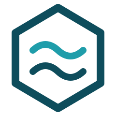

<p align="center">
  <picture>
    <source media="(prefers-color-scheme: dark)" srcset="assets/images/logo-dark.svg">
    
  </picture>
</p>

<h1 align="center">Afon</h1>

<p align="center">
  <b>A cluster-aware delivery pipeline for Kubernetes and k3s.</b><br>
  Pluggable engine. Interactive visual UI. Git to verified deployment.
</p>

<p align="center">
  
  
  
</p>

<p align="center">
  <a href="#why-afon">Why Afon</a> ·
  <a href="#status">Status</a> ·
  <a href="#quick-start">Quick start</a> ·
  <a href="#features">Features</a> ·
  <a href="#architecture">Architecture</a> ·
  <a href="#comparison">Comparison</a> ·
  <a href="#license">License</a>
</p>

---

Afon connects to an existing cluster, maps its active infrastructure, and runs an end-to-end delivery pipeline from git to a verified running deployment.

Instead of rewriting or replacing your favorite infrastructure utilities, Afon provides a unified framework to drop in third-party tooling (security scanners, build engines, GitOps agents), driven by a local CLI and visualized in an interactive web control plane.

> [!NOTE]
> **Early, learning project.** `inspect`, the flow engine, the Kubernetes driver and release records with rollback exist today. Pipeline nodes are partial, and the plugin runtime and visual web control plane are still on the roadmap. See [Status](#status).

## Why Afon

Afon was born out of a desire to deeply understand the internals of Kubernetes delivery systems, Go concurrency mechanics, and low-level resource streaming via the Kubernetes API. It takes a distinct approach to combat DevOps toolchain fatigue:

| Principle | What it means |
|---|---|
| **Adapt to the cluster you have** | Most self-hosted deploy platforms expect a blank canvas. Afon probes your live cluster first (ingress, storage, CRDs, permissions) and compiles plans tailored to it. |
| **Pluggable node ecosystem** | An open framework, not a proprietary one. Plug in tools like **Trivy, ArgoCD, or custom test binaries** through language-agnostic executable/gRPC interfaces. |
| **Local-first, visual when you want it** | Run everything from your terminal, or type `afon ui` for a single-binary visual canvas that maps your clusters and pipeline graphs in real time. |
| **Pre-flight guarantees** | Pipelines evaluate real cluster boundaries, such as **scheduling headroom** and RBAC access reviews, and fail safely at `plan` before applying anything invalid. |

## Status

| Area | State |
|---|---|
| `afon inspect` (cluster profiling engine) | ✅ Implemented |
| `flow.yaml` parser, validation layer and DAG engine | ✅ Implemented (no cluster: `validate`, `plan`, `apply` on a fake driver) |
| Manifest rendering (`afon render`, `--check`) | ✅ Implemented |
| Kubernetes driver: SSA plan/apply, owner-scoped prune, readiness waiter, delete prompt, plan header | ✅ Implemented (k3d / kind / k3s) |
| Release records and health-gated rollback (`history` / `status` / `rollback`) | ✅ Implemented (k8s driver) |
| Pipeline nodes: `git-source`, `image-build` (kaniko Jobs under PSA baseline) | 🟡 Partial (`trivy-scan` and Helm planned) |
| Language-agnostic plugin and extension runtime | 🗓️ Planned |
| Web UI and real-time topology map (`afon ui`) | 🗓️ Planned |
| Multi-cluster aggregated control plane agent | 🗓️ Planned |

## Quick start

Try the runnable example in [`examples/hello-app`](examples/hello-app) against a local k3d, kind or k3s cluster.

```bash
# 1. See what your cluster looks like (read-only)
afon inspect

# 2. Render, preview, and apply the example
afon render -f examples/hello-app/flow.yaml
afon plan   -f examples/hello-app/flow.yaml --driver k8s --context k3d-dev
afon apply  -f examples/hello-app/flow.yaml --driver k8s --context k3d-dev

# 3. Check what was released, and roll back if needed
afon history  -f examples/hello-app/flow.yaml --driver k8s --context k3d-dev
afon rollback -f examples/hello-app/flow.yaml --driver k8s --context k3d-dev
```

No cluster handy? The flow engine also runs against a fake driver. See [Flow engine](#flow-engine-no-cluster).

## Features

### Cluster inspection

`afon inspect` is read-only. It connects using your active kubeconfig, builds a structured **cluster profile** of facts, and prints a text summary or raw JSON.

```bash
afon inspect                 # text summary for the current context
afon inspect -n my-app       # target a specific namespace
afon inspect -o json         # full profile as JSON
afon inspect --full          # include raw /readyz endpoints and full API lists
afon inspect --redact        # scrub server URLs, UIDs, node names, and IPs
```

<details>
<summary><b>What the profile contains</b></summary>

<br>

| Section | Facts |
|---|---|
| `identity` | Context, server, cluster UID, flavor (distribution, version suffix, provider ID), environment (for example k3d) |
| `version` | Server version, client-go version, minor-version skew |
| `discovery` | API groups and resource counts, plus detected capabilities (Traefik, Gateway API, cert-manager, Argo CD, Flux, Kyverno, metrics-server, and others) |
| `health` | `/readyz` result, CoreDNS readiness, `kube-system` workload readiness |
| `nodes` | Per node: capacity, allocatable, conditions, taints, labels, runtime, pod CIDRs. Cluster and per-node requested resources and **scheduling headroom** |
| `access` | Full rules for the target namespace, plus 32 curated permission checks for what a deploy pipeline needs (apply, prune, wait, release records, logs) |
| `namespace` | Existence, phase, labels (including Pod Security), quotas, limit ranges |
| `networking` | Ingress classes (and which is default), Gateway API classes, gateways and routes, network policies, CNI hints |
| `storage` | Storage classes (and default), PVs, PVCs |
| `sections` | A status for every section: `ok`, `partial`, `denied`, or `unavailable` |

</details>

<details>
<summary><b>Design principles of the profile</b></summary>

<br>

- **Facts only:** The profile records concrete parameters (for example, "ingress classes: traefik (default)"). It never makes subjective judgments; evaluation and rule checking belong to higher validation layers.
- **Structured failure:** Every cluster section has an isolated state, and errors are mapped as structured `ProbeError` signatures. "No ingress controller found" and "unauthorized to read ingress controller" are distinct outcomes.
- **`[]` versus `null`:** An empty list means a resource was verified but none exist. A null value means that area was skipped or not probed.
- **Per-namespace by default:** Cluster-wide exploration is opt-in, which keeps pipelines fast and respects namespace boundaries.
- **Scheduling headroom is not usage:** Headroom is allocatable capacity minus existing pod requests. It shows what size workload can realistically be scheduled next, not current RAM/CPU consumption.
- **Safe to share:** Labels and annotations pass through an explicit allowlist, timestamps use UTC, and `--redact` strips network identifiers, IPs, and host names.

</details>

### Flow engine (no cluster)

The flow pipeline runs end to end against a **fake driver**: no Docker, no cluster. State (action cache and fake objects) lives in `.afon/` next to the flow file, so reruns across processes are real no-ops.

```bash
afon validate -f flow.yaml   # parse + compile: types, references, cycles
afon plan     -f flow.yaml   # read-only preview: cached/will-run, create/update/none
afon apply    -f flow.yaml   # re-plan, then execute; banner confirms no cluster is touched
```

```bash
afon plan  -f flow.yaml --parallelism 8   # cap concurrent nodes (default 4)
afon apply -f flow.yaml --state-dir /s    # override state location (default: flow file's dir)
afon plan  -f flow.yaml -o json           # machine-readable plan
```

| Kind | Plan statuses |
|---|---|
| Actions | `cached`, `will-run` |
| Resources | `create`, `update`, `delete`, `none`, `known-after-apply` (an upstream action's outputs don't exist yet) |

A plan's `will-run` is an upper bound. Apply reports what actually happened, with a per-node detail: `succeeded (cached)`, `succeeded (created ConfigMap/hello)`, or `succeeded (no changes)`.

### Kubernetes: render → plan → apply

The same engine drives a real cluster through the Kubernetes driver.

```bash
afon render -f examples/hello-app/flow.yaml          # materialize generated.yaml (provenance header)
afon render -f examples/hello-app/flow.yaml --check  # exit 1 if stale; prints the would-be content
afon plan   -f examples/hello-app/flow.yaml --driver k8s --context k3d-dev
afon apply  -f examples/hello-app/flow.yaml --driver k8s --context k3d-dev
```

**Before your first apply:**

- **Plan is read-only.** It uses server-side dry-run classification plus a label-scoped LIST for pruning (owner labels `afon.dev/flow` / `afon.dev/node`). Objects owned by another flow are refused, never adopted. The previous release's inventory covers the rest: objects the flow no longer owns, including a kind removed entirely, are deleted after a live read confirms them. Disable both halves with `--no-prune`.
- **Deletes ask first.** If the plan contains deletes, apply prompts `plan deletes N object(s); apply these changes? [y/N]`. Non-interactive stdin (pipes, CI) refuses instead of guessing; pass `--auto-approve` to proceed.
- **Apply waits for readiness** for Deployment/StatefulSet/DaemonSet rollouts, Job completion, and Pod containers. The default timeout is 5m (`--wait-timeout`); `0` means no deadline (the context bounds it); `--no-wait` skips.
- **Namespace** comes from `spec.target.namespace` in the flow (required for the k8s driver). `--context` overrides `spec.target.context`. Apply and rollback create a missing namespace before writing anything — the target namespace plain (no labels), the build namespace `afon-build` with the PSA baseline labels kaniko needs; existing namespaces are never modified, and plan/validate/status/history never create anything.

<details>
<summary><b>Output details: plan header and stderr banner</b></summary>

<br>

Text mode prints a header on stdout after planning:

```
driver: k8s context: … namespace: … force: off prune: on
```

A one-line banner on stderr (`k8s driver: context=… namespace=…`) prints earlier, *before* connecting. It is the only context signal in `-o json` mode and when discovery fails, so both exist on purpose.

</details>

### Release records and rollback

Every apply writes an immutable release record (`afon.release.<flow>.v<N>`, a Secret in the target namespace, last 10 kept). Records need the k8s driver; other drivers refuse with `release records require the k8s driver (pass --driver k8s --context ...)`.

```bash
afon history  -f flow.yaml --driver k8s --context k3d-dev   # newest-first: SEQ STATUS TRIGGER AGE OBJECTS
afon status   -f flow.yaml --driver k8s --context k3d-dev   # latest release vs live: missing / recreated / changed / extra
afon rollback -f flow.yaml --driver k8s --context k3d-dev   # prompt-confirm replays the previous release; --to K picks one
```

- **`status`** diffs the newest comparable record's inventory against live objects, and stops with an info line when the latest run is still pending or failed.
- **`rollback --to K`** dry-runs first, replays K's recorded manifest streams as resource nodes (prompt-confirm for deletes, like apply), and appends a new `rolledback` record. Nothing is overwritten. `--to 0` (default) picks the newest restorable release before the latest.
- **Automatic rollback:** a node with `onFailure: rollback` arms it. When any node fails (a readiness wait fails the node too), the previous release is restored automatically with a `rolling back to release K` notice on stderr, no prompt, and a `rolledback` record.
- **Crash detection:** a fresh `pending` record blocks a concurrent apply (wait, or use `--takeover`). A stale one (>10 min) is reported as a probable crashed run and superseded by `--takeover`.

> [!WARNING]
> Rollback restores recorded manifests only. It does not cover database migrations, volume contents, CRD schema changes, or anything outside the cluster (see design.md §3).

## Architecture

> The sections below describe the design direction. Parts of it are still on the roadmap; see [Status](#status).

### Core engine

```
flow.yaml → validate → plan → apply → wait ready → release record → (onFailure: rollback)
              │          │       │
              │          │       └─ concurrent execution via Go DAG channels
              │          └─ server-side dry-run diffing & headroom confirmation
              └─ strict schema checks, input/output validation, and cycle detection
```

A **flow** is a collection of modular **nodes** with execution dependencies. Nodes come in two types:

| Node type | Role | Examples |
|---|---|---|
| **Action** | Executes commands and produces outputs. Content-addressed: if explicit inputs are unchanged, Afon flags the node `CACHED` and skips it. On a cache miss, `image-build` also probes the registry anonymously — if `<image>:<git-sha>` already carries this build's config label, the Job (and the push) is skipped. | `git-source`, `image-build`, `trivy-scan` |
| **Resource** | Represents desired cluster state. Diffs against live infrastructure using the API server's native server-side dry-run. | `k8s-apply` |

Action outputs feed Resource configuration (for example, matching a container build digest to a manifest), keeping deployments locked to explicit hashes.

### Flow file (`flow.yaml`)

```yaml
apiVersion: afon.dev/flow/v1
kind: Flow
metadata:
  name: hello-world
spec:
  target:
    context: k3d-dev          # target kubeconfig context
    namespace: hello
  nodes:
    - id: security-scan
      type: extension/trivy   # pluggable node
      config:
        severity: HIGH,CRITICAL

    - id: image
      type: image-ref
      config:
        ref: docker.io/library/nginx:1.27

    - id: manifests
      type: k8s-manifests
      config:
        paths: [./deploy]
        images:
          app: ${image.ref}   # substitute another node's output

    - id: apply
      type: k8s-apply
      config:
        manifests: ${manifests.rendered}
        wait: { timeout: 120s }
      onFailure: rollback     # restore the previous release if this node fails
```

### Extensions *(planned)*

Extensions are decoupled, language-agnostic binaries that follow a strict input/output contract. With a unified payload model over gRPC or stdout pipes, you can write your own automation or wire up native tools (like Argo workflows) without changing the Afon compiler.

### Web UI: `afon ui` *(planned)*

`afon ui` boots an embedded web server with a visual view of your deployment lifecycles:

- **DAG visual designer:** drag, drop, and link plugin nodes on a canvas to compile the underlying `flow.yaml`.
- **Live infrastructure grid:** watch namespaces, pod transitions, and node mapping update in real time over WebSockets.

## Comparison

| Compared to | The difference |
|---|---|
| **Local task engines** (Dagger, Earthly) | Great at container isolation and local builds, but without native cluster awareness, live target validation, or deployment lifecycle tracking. |
| **GitOps controllers** (ArgoCD, Flux) | These run inside clusters and are heavy to run locally. Afon is lightweight and CLI-first, and can orchestrate apps locally or "eject" native custom resources to your existing GitOps setup. |
| **Developer platforms** (Backstage, Port) | Instead of a heavy portal, Afon is a single binary that wraps your existing tooling in clean visual feedback. |

## License

Copyright 2026 MRGHOSJ. Licensed under the [Apache License, Version 2.0](LICENSE).

Unless required by applicable law or agreed to in writing, software distributed under the License is distributed on an "AS IS" BASIS, without warranties or conditions of any kind. See [LICENSE](LICENSE) for the full text and limitations.
